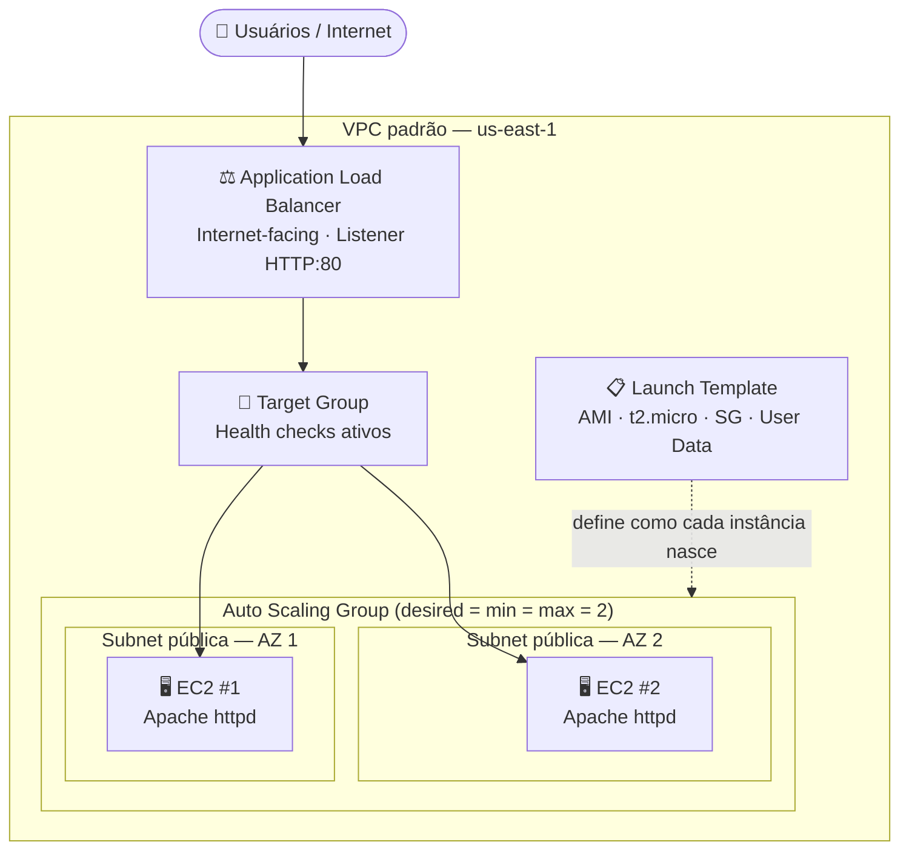

# Infraestrutura Web Resiliente na AWS
### Alta disponibilidade e escalabilidade com Application Load Balancer e Auto Scaling Group


## 📌 Visão Geral

### O problema de negócio
Uma aplicação web hospedada em **uma única instância** tem um ponto único de falha (*single point of failure*). Imagine o site de uma loja virtual na semana da Black Friday:

- Se o servidor cair, **as vendas param** até alguém intervir manualmente.
- Se o tráfego crescer além da capacidade, o site fica lento e **o cliente abandona o carrinho**.
- Se cada servidor for configurado "na mão", surge o clássico *"funciona numa máquina e na outra não"*.

### A solução
Esta arquitetura combina **Application Load Balancer**, **Auto Scaling Group** e **Launch Template** para entregar:

| Requisito de negócio | Como a arquitetura atende |
|---|---|
| **Alta disponibilidade** | Instâncias distribuídas em mais de uma Zona de Disponibilidade (AZ). Se uma falhar, o ASG cria outra e o ALB só envia tráfego para as saudáveis. |
| **Escalabilidade** | O ASG ajusta a quantidade de instâncias (neste projeto, capacidade fixa em 2; a estrutura está pronta para políticas de escala). |
| **Consistência** | Toda instância nasce do mesmo Launch Template, com o mesmo script de inicialização. |
| **Baixo esforço operacional** | Recuperação de falhas automática, sem intervenção manual. |

## 🏗️ Arquitetura



## 🧩 Componentes de Arquitetura

| Componente | Papel na arquitetura | Decisão de projeto |
|---|---|---|
| **VPC padrão + 2 subnets públicas** | Rede onde tudo roda | Subnets em AZs diferentes, com rota para o Internet Gateway, para tolerar a queda de uma AZ |
| **Security Group** | Firewall virtual das instâncias | Libera HTTP (80) e HTTPS (443); sem SSH, pois não há acesso remoto às instâncias |
| **Launch Template** | "Receita" padronizada da instância | Amazon Linux 2023, `t2.micro`, sem key pair, User Data para instalar o servidor web |
| **Auto Scaling Group** | Mantém o número desejado de instâncias saudáveis | Capacidade 2/2/2; health check do ELB habilitado, para substituir instâncias que não respondem |
| **Application Load Balancer** | Distribui o tráfego entre instâncias saudáveis | Scheme *internet-facing*, listener HTTP:80 |
| **Target Group** | Lista de destinos do ALB + regras de health check | Registro/remoção de instâncias feito automaticamente pelo ASG |

## ⚙️ Passo a Passo Técnico (simplificado)

> Região: `us-east-1`.

### 1. Rede
- Usar a **VPC padrão** e selecionar **2 subnets públicas em AZs distintas**.
- Validar que a tabela de rotas aponta `0.0.0.0/0` para um **Internet Gateway** (`igw-*`).

### 2. Security Group
| Direção | Protocolo | Porta | Origem |
|---|---|---|---|
| Inbound | HTTP | 80 | 0.0.0.0/0 |
| Inbound | HTTPS | 443 | 0.0.0.0/0 |
| Outbound | All | All | Padrão |

### 3. Launch Template
| Parâmetro | Valor |
|---|---|
| AMI | Amazon Linux 2023 |
| Instance type | `t2.micro` |
| Key pair | Não incluído |
| Subnet | **Não definida aqui**; quem decide é o ASG, o que permite distribuir entre AZs |
| Security Group | O criado no passo 2 |
| Storage | 8 GiB (padrão) |

**User Data** (bootstrap automático da instância):

```bash
#!/bin/bash
dnf update -y
dnf install -y httpd
systemctl start httpd
systemctl enable httpd
echo "<h1>Servidor Web - Instância: $(hostname -f)</h1>" > /var/www/html/index.html
```

- `systemctl enable` garante que o Apache volte sozinho após reinicializações.
- A página exibe o hostname da instância, o que **torna o balanceamento visível** no teste.

### 4. Auto Scaling Group + ALB
| Parâmetro | Valor |
|---|---|
| Launch Template | Versão *Default* |
| Subnets | 2 subnets públicas, AZs diferentes |
| Load balancer | Novo **ALB**, *Internet-facing*, listener `HTTP:80` |
| Target Group | Novo, com **ELB health checks ativados** no ASG |
| Capacidade (desired / min / max) | 2 / 2 / 2 |
| Scaling policies | Nenhuma (capacidade fixa nesta versão) |
| Tag | `Name = WebServer-CamilaMota` |

### 5. Validação
1. Aguardar ~5 minutos (instâncias iniciam, executam o User Data e passam no health check).
2. Confirmar no Target Group que os 2 alvos estão **healthy**.
3. Acessar o **DNS name** do ALB no navegador.
4. Atualizar a página várias vezes: o **hostname muda**, comprovando a distribuição entre as instâncias.

> 📸 [](docs/screenshots/ALB_CamilaMota_1.png)

### 6. Limpeza de recursos (evitar custos)
Ordem de exclusão: **ASG → Load Balancer → Target Group → Launch Template → Security Group**.
Excluir o ASG primeiro encerra automaticamente as instâncias que ele gerencia.

## 🔧 Desafios e Aprendizados

### Pontos de atenção mapeados (troubleshooting)
| Sintoma | Onde investigar |
|---|---|
| Página sem resposta | Regras de entrada do Security Group, IP público das instâncias, listener e regras de roteamento do ALB |
| Instâncias *unhealthy* | Execução correta do User Data e regras do Security Group entre ALB e instâncias |

### Aprendizados de arquitetura
- **Launch Template vs. ASG:** o template define *como* a instância é; o ASG decide *onde* e *quantas*. Por isso a subnet fica no ASG.
- **Health check do ELB vs. do EC2:** sem o health check do ELB, o ASG só sabe se a VM está ligada, não se a aplicação responde.
- **Tempo de convergência:** o ambiente leva alguns minutos para ficar saudável (boot, User Data, health check).
- **Custos:** ALB e EC2 cobram enquanto existirem; a ordem de limpeza importa.

## 🚀 Próximos passos (roadmap)
- [ ] Reproduzir a infraestrutura com **Terraform** (`/terraform`)
- [ ] Restringir o Security Group das instâncias para aceitar tráfego **apenas do Security Group do ALB**
- [ ] Mover instâncias para **subnets privadas** (com NAT Gateway)
- [ ] Habilitar **HTTPS** no ALB com certificado do ACM
- [ ] Adicionar **política de Target Tracking** (ex.: CPU a 50%) e alarmes no CloudWatch

## 📁 Estrutura do repositório
```
.
├── README.md
├── docs/
│   └── screenshots/

```
